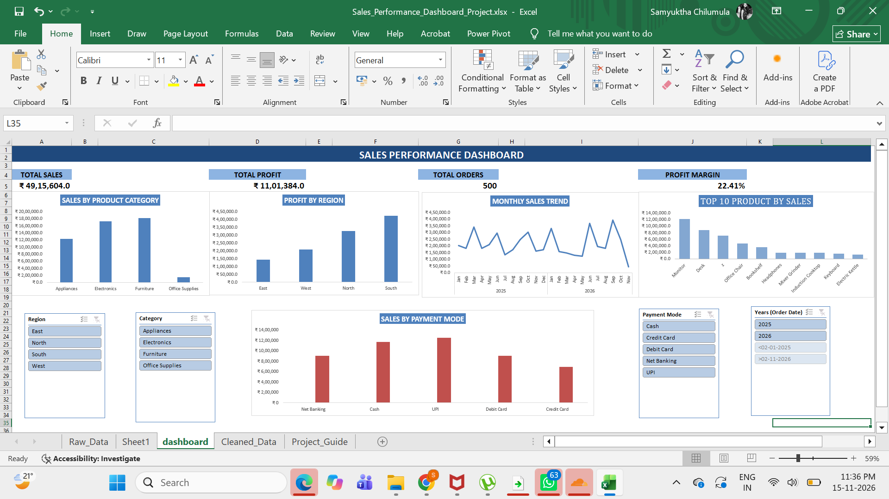

# excel-sales-performance-dashboard
Interactive Sales Performance Dashboard using Microsoft Excel
# 📊 Sales Performance Analysis and Interactive Dashboard using Microsoft Excel

## 📌 Project Overview
This project focuses on analyzing retail sales data using Microsoft Excel and creating an interactive dashboard to understand business performance.

The dashboard presents key performance indicators (KPIs), sales trends, product performance, regional profitability, and payment method analysis.
## 🖼️ Dashboard Preview

## 🛠️ Tools and Skills Used
- Microsoft Excel
- Data Cleaning and Preparation
- Excel Tables and Formulas
- PivotTables
- PivotCharts
- Interactive Slicers
- Data Visualization
- Business Insights

## 🧹 Data Cleaning
- Removed duplicate Order IDs.
- Handled missing and whitespace-only customer names.
- Standardized date and numerical formats.
- Prepared cleaned data for analysis.

## 📈 Key Performance Indicators (KPIs)

| Metric | Value |
|---|---:|
| Total Sales | ₹49,15,604 |
| Total Profit | ₹11,01,384 |
| Total Orders | 500 |
| Profit Margin | 22.41% |

## 📊 Dashboard Visualizations

1. Sales by Product Category
2. Profit by Region
3. Monthly Sales Trend
4. Top 10 Products by Sales
5. Sales by Payment Mode

## 🎛️ Interactive Dashboard Features

The dashboard includes four interactive slicers:

- Region
- Product Category
- Payment Mode
- Year

These slicers allow users to filter the dashboard and explore sales performance from different perspectives.

## 💡 Key Business Insights

- Furniture generated the highest sales among the product categories.
- South recorded the highest regional profit.
- Monitor ranked first among the displayed Top 10 products by sales revenue.
- UPI generated the highest revenue among the payment methods.

## 📁 Project File

`Sales_Performance_Dashboard_Project.xlsx`

The Excel workbook contains the sales dataset, cleaned data, analysis, PivotTables, PivotCharts, and interactive dashboard.

## 🎯 Learning Outcomes

Through this project, I gained practical experience in:

- Cleaning and preparing raw data.
- Creating PivotTables and PivotCharts.
- Building interactive Excel dashboards.
- Calculating and presenting KPIs.
- Identifying business trends and insights.

---

**This project is part of my journey towards becoming a Data Analyst.**
